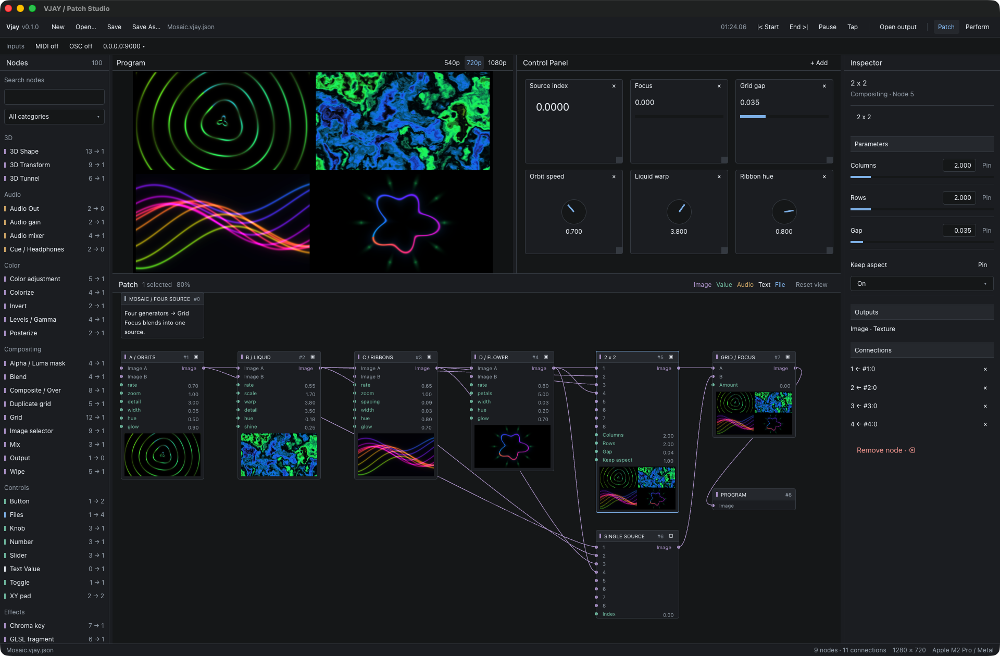

# VJAY

A node-based VJ application built with Rust, GPUI, and WebGPU through wgpu.
Create visual patches, build custom performance controls, and route multiple video outputs.



See [docs](docs/INDEX.md) for architecture, usage, and sample projects.

## Build

```sh
cargo build --release
cargo run --release
```

## Dependencies

- Rust 1.95 or later. Cargo manages the Rust dependencies and pins versions in `Cargo.lock`.
- macOS with Metal and Apple Command Line Tools, or Windows with a DirectX 12 GPU.
- `ffmpeg` and `ffprobe` on `PATH` for video and audio playback.
- Windows source builds: MSVC C++ Build Tools, Windows SDK with FXC, CMake, and Strawberry Perl
  on `PATH` for the bundled SQLCipher/OpenSSL dependency. Native GPU movie decoding and camera input are macOS-only.
- Optional: `yt-dlp` with a supported JavaScript runtime for URL imports; NDI Runtime,
  Syphon, or the Windows Spout bridge for video sharing.

See [build and integration setup](docs/BUILD.md) and [dependency licenses](docs/THIRD_PARTY.md).
