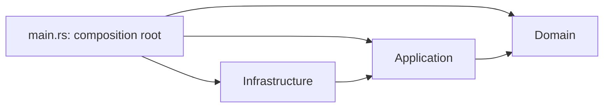

# Architecture

VJAY uses layered architecture with ports and adapters. The domain describes the patch;
application services compile and execute it through interfaces; infrastructure supplies
GPUI, wgpu, storage, media, and native integrations. `src/main.rs` is the composition root.

## Dependency direction



Each layer is a separate Cargo crate. Domain never imports application or infrastructure.
Application never imports infrastructure, GPUI, wgpu, or native window APIs.
Infrastructure may use both inner crates. Cargo manifests enforce these boundaries.

```text
src/
  main.rs
  domain/
    Cargo.toml
    vjay_domain.rs
    node.rs
    graph.rs
    graph/
      ports.rs
  application/
    Cargo.toml
    vjay_application.rs
    session.rs
    compiler.rs
  infrastructure/
    Cargo.toml
    vjay_infrastructure.rs
    gpu.rs
    ui.rs
```

Modules follow normal Rust file conventions: `graph.rs` and `graph/ports.rs`.
Do not introduce `mod.rs`, ordinary `#[path]` indirection, or another crate-named
folder inside a layer. Keep files near 200–300 lines where practical, below 1,000 lines.

## Design principles

- **Dependency inversion:** application defines the capabilities it needs as ports.
  Infrastructure implements those ports; application does not select concrete adapters.
- **Explicit composition:** assemble concrete dependencies in `main.rs`. Keep platform
  branches and implementation feature selection outside application and domain.
- **Open node definitions:** adding a node must not require changing a central node-kind
  enum, the graph representation, or a renderer switch over concrete node types.
- **User-controlled patches:** adding a node does not create wires. Controls, reconnects,
  insertion, and explicit setup actions preserve the user's ownership of the patch.
- **Separate editing from playback:** resolve topology, schemas, resources, and bindings
  during preparation. Use compact compiled schedules during playback.
- **Bound resource use:** give workers, caches, texture pools, and transfer queues explicit
  limits. Prefer the latest usable frame over an unbounded backlog.
- **Measure performance:** distinguish CPU compilation time, GPU execution, decoder
  delivery, and UI behavior. Do not infer realtime FPS from headless timings.

## Domain: nodes and graph invariants

Every processing node implements [`Node`](../src/domain/node.rs). A definition supplies
its descriptor, instance schema, capabilities, validation, and supported kernels.
`NodeRecord` stores an instance's stable ID, open string type identifier, parameters,
settings, and optional asset reference.

`NodeFactory` abstracts definition lookup. `NodeRegistry` stores registered definitions
in a vector and validates duplicate IDs and metadata. Built-in IDs belong to the concrete
definitions; they are not a closed `NodeKind` in the domain contract. The saved JSON
field `kind` holds an open string identifier, not a Rust enum. Unknown serialized IDs
fail explicitly rather than being silently replaced.

A node can declare multiple typed inputs and outputs. Texture, Scalar, Audio, Text, and
File describe connection protocols, not the set of node implementations. Parameters also
expose scalar input ports. `schema(settings)` supports instance-specific layouts, including
named GLSL uniforms. Capabilities describe UI and runtime behavior without concrete-type
checks in consumers.

Kernels are provided through the abstraction: `image()`, `scalar()`, `text()`, and `file()`.
Image kernels describe shaders and uniform bindings. Scalar, text, and file schedules use
evaluation function pointers. Complex execution adapters are not embedded in node records.

### Output-owned registrations

Each `OutputPort` owns a `Vec<InputPortRef>` of destinations. This is the authoritative
editable connection representation. Input-side bindings are derived compiled data.

```rust
let output = graph.output(source_node, 0)?;
let input = graph.input(target_node, 0)?;
graph.register(output, input)?;
```

Wiring checks types, input occupancy, and cycles before committing. Failed reconnects
restore the original registration. `connections()` provides a read-only iterator for
serialization and UI; it is not another independently mutable edge collection.

Graph records are dense. A stable-ID index supports editing and UI lookup; it is not a
per-frame routing table. Graph deletion updates indices and registrations. Application
removes affected control references and rebuilds bindings before evaluation. IDs are not recycled.

## Application: use cases and execution plans

`Session` coordinates editing, transport, signals, media timing, project files, and output
selection. It depends on ports, not concrete UI or GPU objects.

| Port or factory | Responsibility |
| --- | --- |
| `RuntimeFactory` | Create a compatible renderer, clock, control input, and related services |
| `RenderBackend` | Prepare a plan, render, expose output metadata, and perform explicit capture |
| `VideoDecoderFactory` / `VideoDecoder` | Open and deliver media frames |
| `ImageLoader` / `PreparedImageFactory` | Load still images or prepare generated text images |
| `AssetSourceFactory` | Resolve URL imports and selectable file collections |
| `AudioFactory` / `AudioBackend` | Build and drive optional audio routes |
| `ControlIo` / `ServiceFactory` | Receive controls and create external service instances |
| `ProjectStore` | Load and save project documents at selected locations |
| `Clock` | Supply monotonic time independently of UI redraws |
| `Platform` | Run desktop or headless application lifecycles |

These factories create compatible groups of components. For example, a runtime keeps the
renderer and presentations on the same GPU context. `main.rs` injects implementations and
registries, including optional service and video-sharing providers.

### Compilation instead of runtime graph traversal

On a relevant edit, the compiler:

1. Resolves output registrations into dense input bindings.
2. Finds the union of connected output roots and enabled node previews.
3. Validates required inputs and obtains kernels in topological order.
4. Computes the final use of intermediate images and assigns reusable texture slots.
5. Resolves parameters, scalar values, text, file signals, and audio routes to slots.

Topological sorting is O(V + E). Input binding construction is O(V + K + E), where K is
the total number of input slots. Definition lookup is linear in registered types and
belongs to editing/preparation. Playback does not look up node definitions by string ID.

Scalar values and state use dense arrays with reusable scratch storage. Text values share
`Arc<str>`; file values use `Option<Arc<Path>>`. Type-specific schedules use resolved slots.
The graph's stable-ID map is not a substitute for these schedules.

Parameter edits can rebuild bindings without rebuilding GPU resources when shader,
resource layout, and topology remain compatible. Moving nodes, resizing panels, and
zooming the patch do not recompile the rendering graph. Schema migrations preserve old
port numbers, parameters, and control references when loading existing projects.

### Editing and failure behavior

Restore validates IDs, assets, finite values, bounds, wires, cycles, controls, and layout
before replacing the active project. Open failures preserve the current patch and location.
Save As changes the active path only after a successful save. JSON writes use a temporary
file, synchronization, and rename in the destination directory; the document limit is 64 MiB.

Missing Program output produces black. Invalid required inputs report a compile error;
disconnected, incomplete branches do not block valid outputs. Failed optional previews
are isolated. An invalid edit is not recompiled repeatedly on every frame.

Copy and paste use an application-owned `PatchFragment`. IDs are remapped and internal
wires are retained before atomically applying the candidate patch. Clipboard and JSON
encoding remain infrastructure responsibilities.

## Infrastructure and the platform abstraction layer

Infrastructure implements application ports with GPUI, wgpu, FFmpeg, CPAL, MIDI, OSC,
JSON storage, and native SDKs. Only this layer and the composition root know platform APIs.

`GpuPresentation` is the presentation PAL inside the rendering adapter. On macOS, native
adapters own the GPUI child `NSView`, `CAMetalLayer`, and wgpu surface. Native handles and
unsafe lifetime management stay inside these adapters. View work runs on the main thread,
and surfaces are released before their native layers.

`PresentationGroup` registers output windows by source node ID and keeps weak references
to presentations. All windows share the GPU device and the compiled plan. Shared branches
render once; each output retains its own final texture through the end of the frame.
Closing a window removes its presentation without changing the patch.

Node previews use the same GPU context. They are encoded after the corresponding node
and clipped to visible patch regions. Scrolling, overlap masks, and panel bounds belong
to UI layout, not domain graph coordinates.

Native desktop presentations are implemented and validated on macOS. Equivalent Windows
and Linux presentation PALs are not implemented. The Windows Spout adapter does not imply
a complete Windows desktop application.

## GPU execution and cache-aware data flow

Preparation creates pipelines, bind groups, textures, and aligned uniform staging. The
steady rendering path consumes the compiled pass array, updates uniforms in batches, and
reuses resources. It does not traverse the editable graph, call each domain `Node` trait,
or create pipelines and bind groups for unchanged playback.

wgpu handles image transforms, compositing, effects, GLSL/WGSL programs, preview scaling,
and output presentation. GLSL is validated and lowered through Naga during preparation.
Texture formats are currently RGBA8Unorm; HDR and a linear-light color workflow are not
implemented.

Content changes remain explicit preparation work: a new file or input format may require
new decode resources. Text is shaped and rasterized when its text, formatting, or extent
changes; the result updates an existing GPU texture. Animating image transforms avoids
rerasterizing text merely to move or scale it.

| Resource | Current bound |
| --- | --- |
| Graph | 256 nodes |
| Render extent | 1–4096 pixels per dimension |
| Compiled image texture budget | 512 MiB |
| GPU pass interface | 8 image inputs and 64 float uniforms |
| Concurrent media sources | 8 video sources; 8 audio sources |
| Shared video inputs | 8 |
| NDI OUT transfer buffers | 512 MiB total |
| Audio PCM cache | 8 MiB per source |
| File collection | 4,096 entries; 4 MiB playlist; 16 cached lists; 8 workers |

These are implementation bounds, not performance guarantees. GPU timestamps, pass fusion,
HDR, dynamic plugin loading, and automatic device-loss recovery are future work.

## Media, clocks, and external services

The signal clock is separate from the media timeline. Pausing media and shader `iTime`
does not pause buttons, envelopes, or LFOs. `render_at` uses a supplied time for deterministic
headless rendering. `PlaybackWindow` applies Speed, Position, Loop, Range, and Seek to both
video and optional monitor audio.

Video workers use bounded requests, results, and recycled buffers. GUI playback requests
the latest frame without waiting; exact delivery is an explicit headless/test policy.
Decoders are reused when node, asset, and extent remain compatible.

macOS selects VideoToolbox decoding and GPU scaling. Unsupported source formats can be
prepared once into a hardware-encoded ProRes cache. Initial decoding of such sources uses
the CPU. RGBA conversion and upload still cross CPU memory, so video input is not zero-copy.
There is no silent CPU playback fallback for the macOS hardware policy.

Audio is optional and requires a route to an audio sink. Cue/headphone output is for the
VJ to monitor material while matching the DJ's independent audio. The audio callback does
not allocate, lock, decode, or read files; workers supply bounded PCM pages. Device discovery
runs when the chooser opens, not on every frame.

Service factories own Link and rekordbox workers. Service events carry values, text, or
files through application ports. The rekordbox adapter reads the original DB and WAL only
through read-only file handles, then queries a private snapshot with read-only SQLCipher
and `query_only`. It never checkpoints, repairs, or opens the original DB with SQLite.
History is delayed metadata, not a reliable live playback-position signal.

### Video-sharing boundary and the readback exception

Opaque `StreamRequest` providers are resolved by the injected `VideoIoRegistry`.
`VideoIoFactory`, `VideoReceiver`, and `VideoSender` encapsulate native SDK details.
Objects and textures persist across ordinary frames; receiver format changes trigger
resource preparation.

- Syphon shares Metal textures. GPU events order native work and wgpu work without CPU
  pixel readback or CPU waits for frame completion.
- Windows Spout uses D3D12 and D3D11On12 GPU texture sharing. Its Windows build and native
  interoperability have not been verified in the macOS development environment.
- Standard NDI sending requires CPU-accessible frames. The explicitly approved exception
  is **NDI OUT only**: two GPU staging frames, three recycled CPU frames, asynchronous
  mapping, and a latest-frame mailbox. Busy transfers drop frames rather than block
  rendering. SDK ownership lasts until the next send/flush; deletion cancels pending maps.
  NDI input decoding hardware use depends on the Runtime, codec, and environment.

Normal effects, node previews, output windows, and Syphon/Spout do not read GPU pixels
back to the CPU. Explicit capture and test exports are separate operations. A sender
failure is reported on that node without stopping independent screen outputs.

## Verification

Use the [build checks](BUILD.md#verification) and the extension, graph, signal, project,
UI, and native GPU tests. Measure changes against a specified workload and platform.
Historical results are preserved under [benchmarks](INDEX.md); they are observations from
individual runs, not claims of optimal or sustained live performance.

## Device settings and manual deck control

`application::preferences` owns validated settings values and the `SettingsStore` port.
The JSON adapter persists settings atomically outside project documents. `AudioBackend`
accepts output configuration; CPAL selects the device, rate, buffer, and channel pair.
A shared atomic gain updates master volume without rebuilding the audio stream. Hardware
changes invalidate prepared audio routes. Render extent and presentation sync are applied
through existing rendering ports. The GPUI PAL resolves display UUIDs into native windows.
`main.rs` injects the settings store and registers each platform's capture adapter.

The Media Device Input node declares an image stream request through the existing video
I/O abstraction. The macOS adapter uses AVFoundation and a latest-frame mailbox, retaining
CVPixelBuffer / CVMetalTexture ownership through Metal completion. MPS writes a persistent
wgpu texture and a shared event orders its use by the render queue. Native capture does not
read pixels on the CPU; only the native frame wrapper changes each frame. Unsupported
platforms report adapter unavailability. Device discovery runs when the picker opens,
rather than during steady rendering. Capture starts asynchronously and is opt-in.

The current media ownership and composition contracts are described below.

## Media commands, feedback, and value controls

The domain declares media command bindings and read-only playback snapshots. Application
`MediaTimeline` owns each source's playhead, range, local Pause state, Nudge and Cue marker.
The same state supplies GPU frame selection, audio rate/position, Inspector transport, and
Playhead feedback outputs. GUI actions and graph inputs become the same transport actions;
video transport never discovers or rewrites a connected controller's internals.

Deck Rate implements `Node` and lowers to a scalar rate kernel. Its capability metadata
describes parameter and output indices; application/UI code uses those bindings without
matching a concrete node ID. Seek Control's declared value-control contract independently
identifies its request parameter, feedback input, request output, optional request-trigger
output and display output. Parameter edits notify the control node, which emits a graph
pulse to distinguish repeating a request from observing an unchanged value.
A slider can therefore display observed playback while preserving the user's last command.
New control implementations can provide the same contract with different port layouts.

Control readouts are independent of interaction values. The application stores a numeric
format plus optional scalar readout/total output indices on each Control Panel binding.
GPUI uses that presentation contract for sliders, meters, knobs, numbers and numeric labels.
Timecode formatting consumes seconds without rewriting graph values or control ranges.
Seek Control accepts generic readout values through ordinary ports; the explicit media
setup connects elapsed seconds and duration. No formatter looks up a concrete video node,
and readout bindings stay local to their bound node when copying or nesting patches.

`Node::feedback` lowers snapshot producers separately from ordinary scalar kernels.
Delayed output metadata permits feedback cycles; their snapshot kernels publish first.
The rest of the compiled scalar schedule remains ordered. Source commands are processed
by one source-local state machine and increment a Seek revision even when recalling an
unchanged position, so video and audio both receive the Seek. Legacy Deck Sync definitions
and connection migrations remain available, but new rate controllers contain no clip state.

## Hierarchical editing and flat execution

Domain nodes expose composition and boundary contracts through `Node`; they do not depend
on an application document type. A generic typed interface describes container ports.
Application documents own nested definitions, optional named-file locations, scope layouts,
controls and assets. In / Out are ordinary registered boundary implementations. The compiler
consumes their declared roles rather than a closed list of concrete node kinds.

Application resolves port aliases into a flat graph on edits. The usual signal, texture,
audio, file, text and service compilers operate on that graph. Container previews use
precompiled render-step registrations, so pooled textures are presented before reuse.
Playback does not recurse through subpatches or call the `Node` trait. Tests compare image
pixels and pass counts before/after nesting and verify no factory calls during steady frames.

Node identities are unique across the project hierarchy. Imports and copies rebase colliding
identities before validation, including layout, bindings, asset references and nested instances.
Boundary keys are independent of display order, names and rebased runtime IDs. Interface edits
therefore remap compatible external wires by identity. Instantaneous cycles are rejected in
the fully expanded graph, including cycles hidden behind container ports.

The active canvas is an editing scope. Parent documents are retained while editing children;
a prepared root snapshot supplies execution and project Save. Named patches use the existing
project-store port. Each project embeds its instance snapshots, avoiding filesystem reads or
surprise external updates during playback. Reload is explicit and a failed read preserves the
existing instance. The same named file may have multiple instances with independent state.
