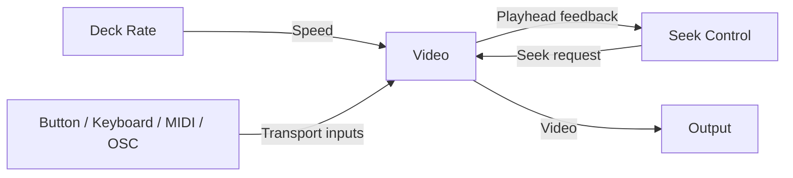
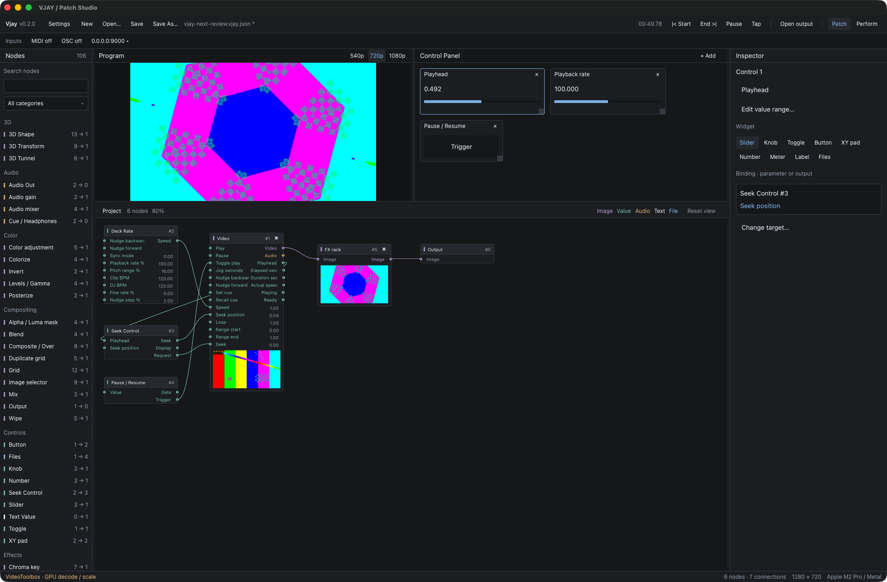
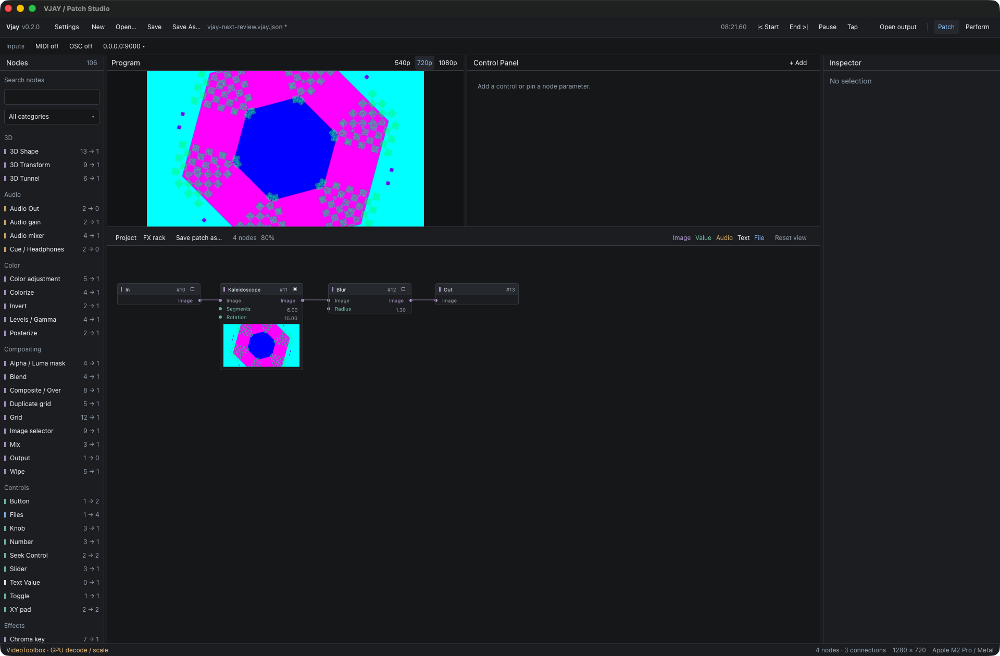

# Subpatches and media transport

## Separate control requests from playback state

Media transport now has three separate responsibilities:

| Component | Responsibility |
| --- | --- |
| Video / Loadable Video / URL video | Own the clip playhead, playback range, local Pause state and Cue marker; apply transport requests; publish playback state |
| Deck Rate | Calculate Speed from a manual percentage or BPM ratio, optionally with held Nudge inputs |
| Seek Control | Publish the user's requested Seek position while displaying the media node's actual Playhead feedback |

Inspecting or controlling a video does not change another node's parameters. A media node
works without a Deck Rate node. Its Inspector sends the same transport actions accepted
by its graph inputs. A connected Speed source remains authoritative for the base rate;
local Pause and Nudge are applied by the media transport to both video and optional audio.

The media node publishes Playhead (0–1 within its selected range), Elapsed seconds,
Duration seconds, Actual speed, Playing, and Ready. Playback feedback is sampled from the
shared media timeline at the start of the next control frame. It is not the last Seek
request. Cue bookmarks are included when saving a project or standalone subpatch.

Playback feedback ports declare a frame delay. The signal scheduler publishes those
snapshots before evaluating ordinary control kernels, allowing feedback connections
without an instantaneous cycle. Ordinary instantaneous cycles remain invalid. The fully
expanded graph validates cycles across subpatch boundaries.

## Match by ear

1. Load Video or Loadable Video, connect its Video output to Output, and select the media node.
2. Under **Transport / Cue**, choose the headphone device and enable **Cue audio**.
3. Use the media node's Seek bar, Jog, Pause/Play, Set cue and Cue controls directly.
4. Press **Add rate control…** if needed. This explicitly creates Deck Rate and connects
   only Speed. Select Deck Rate to edit Playback rate / Pitch range or BPM ratio.
5. Adjust rate until the clip's audio and the floor track stop drifting. Use Nudge to
   correct their phase; the media Inspector's Nudge temporarily changes local speed by ±2%.

The headphone output is shared with Audio Out as configured in Settings. Rate changes also
change audio pitch; automatic beat detection and time stretching are not implemented.

### A seek bar in Control Panel

Press **Add seek control…** on the media node. The explicit setup action creates Seek Control,
connects the following wires, and pins its slider:

- `Video.Playhead` → `Seek Control.Playhead`
- `Seek Control.Seek` → `Video.Seek position`
- `Seek Control.Request` → `Video.Seek`
- `Video.Elapsed seconds` → `Seek Control.Readout value`
- `Video.Duration seconds` → `Seek Control.Readout total`

The slider follows playback because its display reads feedback. Moving it changes the Seek
request, not the feedback value. Request emits a pulse for user edits, so choosing the same
position again performs another seek. You can create and connect these nodes yourself. The helper
refuses to replace an existing Seek position connection. The same arrangement works through
subpatch In / Out ports.

### Choose numeric or time display

Select a Control Panel item. Its Inspector's **Value display** section provides:

- **Format:** Number or `hh:mm:ss.fff` (hours, minutes, seconds and milliseconds).
- **Readout:** the control value, or any scalar output of its bound node.
- **Total:** an optional scalar output displayed after `/` using the same format.

The format is a shared control setting used by Slider, Meter, Number, Knob and numeric
Label items. Timecode interprets its readout as seconds; it does not convert signal units
or change the control's range. It rounds to milliseconds and retains hours beyond 24.

New **Add seek control…** setups use timecode, Readout value and Readout total by default.
For existing Seek Controls, connect the two readout inputs above and choose those outputs
in the Control Inspector. To display normalized values again, choose Number, Control value,
and Total = None. The source's elapsed seconds are absolute clip time, while its normalized
seek position remains relative to the selected playback range.

Readout values enter through ordinary graph wires. Seek Control passes them through
without knowing their units or discovering another node. Any node exposing scalar outputs
can use the same display settings; display bindings also survive subpatch encapsulation.

### Connect transport controls yourself

All transport inputs are optional Value inputs. Button, Keyboard, MIDI, OSC, math nodes,
and subpatches can drive them.

| Media input | Behavior |
| --- | --- |
| Play / Pause / Toggle play | A nonzero transition performs the action; returning to zero rearms it |
| Jog seconds | A nonzero transition moves relative to the current playhead; positive is forward, negative is backward |
| Nudge backward / Nudge forward | Hold a value of 1 for a local −2% / +2% speed adjustment; release to 0 |
| Set cue / Recall cue | A nonzero transition stores / recalls the media node's Cue marker |
| Seek position | Absolute normalized Seek request; applying a new value moves the playhead |
| Seek | Pulse to reapply an unchanged legacy Seek position |

Examples:

- `Keyboard.Trigger` → `Video.Toggle play`
- `Button.Trigger` → `Multiply A`, Multiply B = 0.01, `Multiply.Value` → `Video.Jog seconds`
- `MIDI in.Gate` → `Video.Nudge forward`
- `Button.Trigger` → `Video.Recall cue`

The old serialized `LipSync` / Deck Sync node remains registered for existing projects.
Its old port connections migrate to the new media input indices. Existing graphs are not
rewired automatically. Newly added rate controllers use Deck Rate; they own no playhead,
clip duration, Cue marker or Pause state.

## Create an unnamed subpatch

Select processing nodes, right-click and choose **Create subpatch**, or press
**Cmd/Ctrl+Shift+E**. Their internal connections, settings, media references, controls and
nested subpatches move into the new container. Crossing connections become typed In / Out
ports; fanout is retained. Keep the project's Program Output and existing In / Out boundary
nodes outside the selection.

Double-click the container header, or press **Open subpatch** in Inspector. Breadcrumbs
above the canvas navigate back to a parent; **Cmd/Ctrl+[** goes back one level. The main
Program keeps rendering the entire project while a child patch is open. The child has its
own canvas layout and Control Panel.

For an empty patch, add **Subpatch** from the Patching category and open it. Add **In** and
**Out** nodes inside it, then connect the internal graph. In Inspector, each boundary has:

- **Port name:** the label displayed on the container.
- **Type:** Image, Value, Audio, Text or File.
- **Order:** the port's position in the interface; equal orders use stable creation order.

Changing a name or order preserves compatible external wires by persistent port identity.
Deleting a boundary or changing its type removes wires that no longer have a compatible
port. Internal node IDs remain unique across the whole project, preserving independent
state, MIDI/service routing and media playback when scopes are edited or copied.

## Save and reuse a named patch

Use **Save subpatch as…** on a selected container, or **Save patch as…** in the breadcrumb
bar while editing it. A `.vjay.patch.json` file is a standalone project-format document
containing its nodes, interface, assets, layout and any nested definitions.

Right-click the canvas and choose **Load subpatch…** to instantiate a saved file. Loading
it twice creates independent node and runtime state. An instance's Inspector shows its
source file and **Reload from file**. Reload reads that file; it does not write it. Invalid
files leave the existing instance intact.

Projects embed each instance's definition as a snapshot, even for named patches. Opening a
project does not reread or overwrite external patch files. External changes take effect
when Reload is requested. Project Save saves the whole project, including the currently
open child; saving the standalone definition is a separate explicit action. A standalone
patch file can also be opened directly for editing.

## Execution and limits

Subpatches are expanded and their boundary aliases resolved when preparing an edited graph.
The renderer, signal scheduler, audio routes, media sources and service adapters use the
same flat graph as ordinary nodes. Nesting adds no processing pass or per-frame recursive
traversal. Enabled container previews refer to the resolved image output and are encoded
before its pooled texture can be reused.

Current bounds are eight nesting levels, 32 inputs and 32 outputs per container, 256 nodes
per editable scope, and 256 actual nodes in the expanded execution graph. Documents also
have a 4,096-node hierarchy validation bound. These are explicit resource limits, not
performance claims. The existing eight-texture-input limit applies to each GPU pass.
