# Sample projects

[`sample/`](../sample/) contains ten procedural demos and an anime-club two-deck template.
The numbered demos each have six Control Panel items, produce no audio, and require no
external media or sharing SDKs. Previews below are actual 640×360 GPU captures.

## Open a project

Use **Open…** (Cmd / Ctrl + O) and select a `.vjay.json` file. Use **Save As…** before
keeping a variation. From the repository root:

```sh
target/release/vjay --project sample/01-chromatic-fold.vjay.json
# Also open the Program output window
target/release/vjay --project sample/10-dual-projector.vjay.json --output-window
```

Drag controls to adjust values; Shift gives fine adjustment and Cmd / Ctrl snaps values.
Nodes and wires remain editable. Cmd / Ctrl + wheel zooms the Patch; normal wheel input
pans it. Each image node has an independent preview switch in its header.

## Projects

| Project | GPU preview | Controls and structure |
| --- | --- | --- |
| [01 · Chromatic Fold](../sample/01-chromatic-fold.vjay.json) | 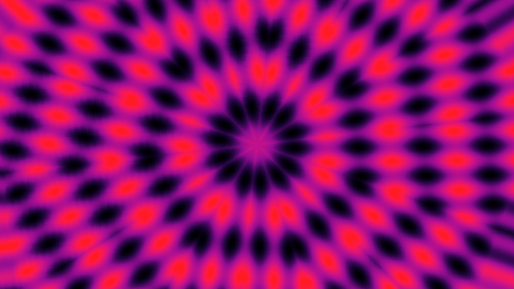 | Mix two Patterns, then fold, colorize, and add a Screen glow. Adjust Hue, Stripe density, Segments, Turn rate, and Glow. Level = 0 blacks out the image. |
| [02 · Neon Orbits](../sample/02-neon-orbits.vjay.json) | 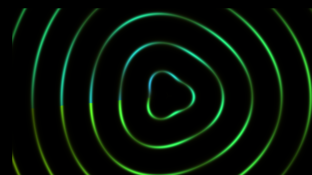 | Two LFOs move GLSL rings. Adjust Speed, Zoom, Ring count, Line width, Palette, and Glow. |
| [03 · Liquid Contours](../sample/03-liquid-contours.vjay.json) | 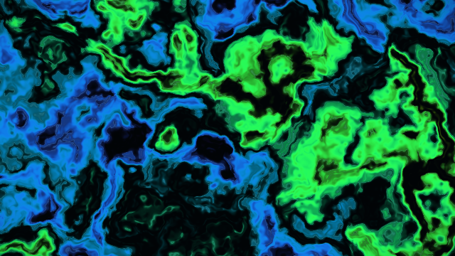 | Five noise octaves generate flowing contours. Adjust Flow speed, Scale, Warp, Contours, Palette, and Highlights. |
| [04 · Tunnel Drive](../sample/04-tunnel-drive.vjay.json) | 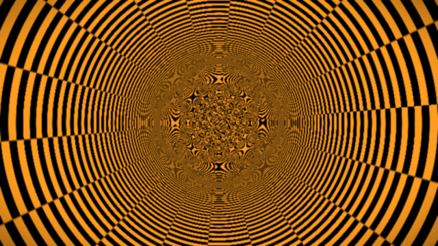 | Checkerboard → Colorize → 3D Tunnel. Negative Travel speed reverses direction. Adjust Depth repeat, Radius, Twist, Tile density, and Hue. |
| [05 · Orbit Sculpture](../sample/05-orbit-sculpture.vjay.json) | 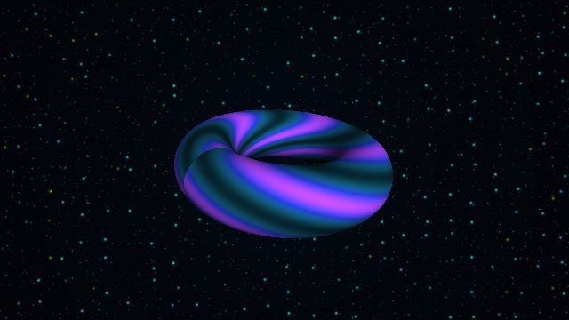 | Two LFOs rotate a 3D Shape over stars. Shape: 0 Sphere, 1 Cube, 2 Torus, 3 Cylinder. Adjust Object size, Texture, Light, Orbit rate, and Surface hue. |
| [06 · Live Type](../sample/06-live-type.vjay.json) | 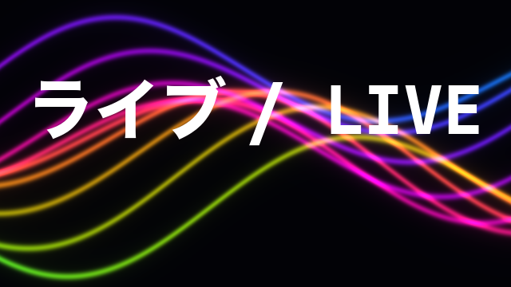 | PUNCH or Space enlarges the title; Release seconds controls its return. Edit the EDIT TITLE Text Value node for new text. Font size/Weight and background Hue/Speed are exposed. Weight: 0 Thin, 3 Regular, 6 Bold, 8 Black. |
| [07 · Tempo Prism](../sample/07-tempo-prism.vjay.json) | 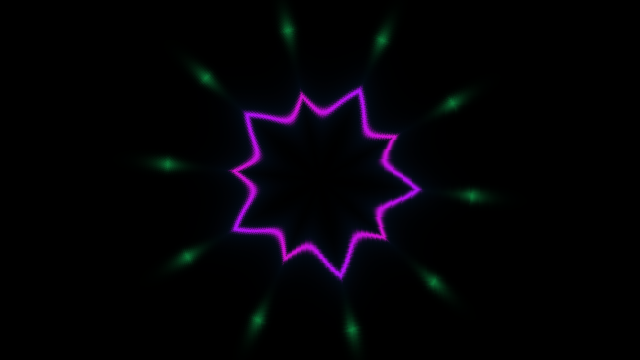 | Tempo → Attack/Release → Multiply → Kaleidoscope. BPM sets the beat, Rotation degrees sets excursion, and Release seconds sets the return. HIT triggers manually; tap in the TAP TEMPO node's Inspector. |
| [08 · Mosaic Router](../sample/08-mosaic-router.vjay.json) | 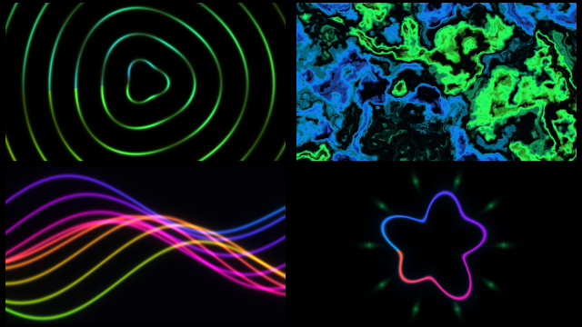 | Four sources feed Grid and Image selector. Focus = 0 shows the grid; 1 shows the selected source. Source index: 0 Orbits, 1 Liquid, 2 Ribbons, 3 Flower. Adjust Grid gap and source motion. |
| [09 · Halftone Print](../sample/09-halftone-print.vjay.json) | 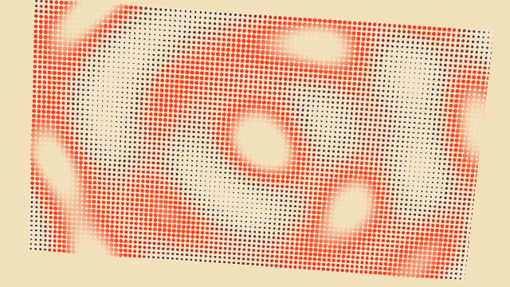 | 3D Transform tilts a halftone over a paper-colored background. Adjust Dot density, Wave mix, Warp, Flow speed, Tilt degrees, and Ink amount. |
| [10 · Dual Projector](../sample/10-dual-projector.vjay.json) | 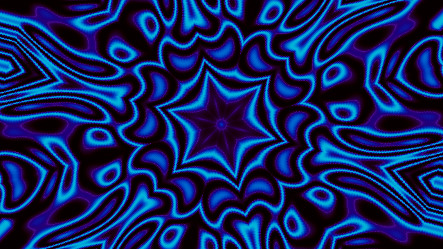 | One shared procedural source branches to A's kaleidoscope and B's tunnel. Shared speed/Warp affect both; A Segments/Rotation and B Travel/Hue are independent. |

## Two output windows

Open `10-dual-projector.vjay.json`:

1. Select the **PROJECTOR A** Output node and press **Open output** in the toolbar.
2. Select **PROJECTOR B** and press **Open output** again.
3. Move the windows to their displays and enable fullscreen as needed.

Program shows A. The independent B window displays this feed:

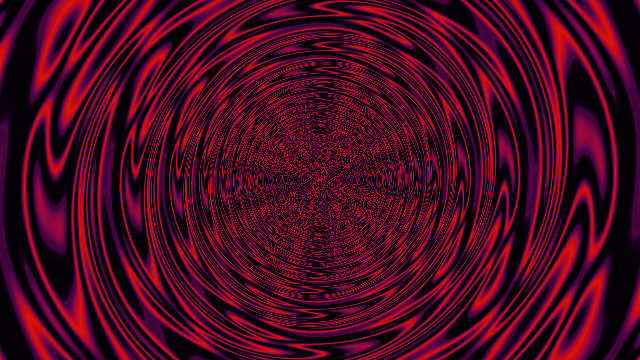

## Anime-club two-deck template

Open [anime-club.vjay.json](../sample/anime-club.vjay.json), or run:

```sh
target/release/vjay --project sample/anime-club.vjay.json --output-window
```

The template contains no copyrighted media, local media paths, or external service
connections. Each empty deck shows an animated Pattern until its video is ready.

1. In Settings, choose the headphone audio output. The DJ's floor audio remains the
   reference; this project routes video audio only to Cue / Headphones.
2. Use **A / Load folder or playlist** and **B / Load folder or playlist** in Control Panel
   to choose your own video files, folders or `.m3u` / `.m3u8` playlists.
3. Each deck has a Seek slider displaying `hh:mm:ss.fff / hh:mm:ss.fff`, Rate %, Listen,
   Loop, Play/Pause, Set cue, Cue, held Nudge −/+, and Jog −/+10 ms controls.
4. Enable **Listen A** or **Listen B** to hear that deck in headphones. Both start off.
   Adjust Rate % to remove drift, Nudge to correct phase, and Jog for small position steps.
   You do not need to know the floor track's BPM. Rate changes also change audio pitch.
5. Crossfade moves the Program image between A at 0 and B at 1. Blackout affects Program
   only; headphone selection and deck transports stay independent. Q toggles A playback;
   W toggles B playback when text inputs are unfocused.

Control Panel scrolls vertically to reveal lower rows. Perform view gives the controls more
space. Both decks are ordinary Files → Loadable Video, Deck Rate, Seek Control and control
nodes. Their patch wiring is editable, and Keyboard/MIDI/OSC nodes can replace or extend
the transport buttons. Empty decks do not disable the other deck's headphone route.

See [readout settings](PATCHING_AND_TRANSPORT.md#choose-numeric-or-time-display) to switch
between numeric and time display or apply timecode to other controls.

## Replace sources or processing

- Replace Pattern or GLSL image outputs with Video, Image, or Loadable Video and reuse
  the downstream processing.
- Edit GLSL code and named uniforms in each node's Inspector. Shader sources are embedded
  in the project and do not require separate files.
- Connect rekordbox Title to Live Type's Text input to replace the constant title source.
- Add the required NDI/Syphon OUT, connect an image, and enable Send for external sharing.

Regression tests check Metal rendering, animation, all outputs, and the Live Type PUNCH
signal route at 640×360. These macOS tests do not establish Windows/Linux presentation
support or guarantee a performance frame rate. See [verification](BUILD.md#verification).
