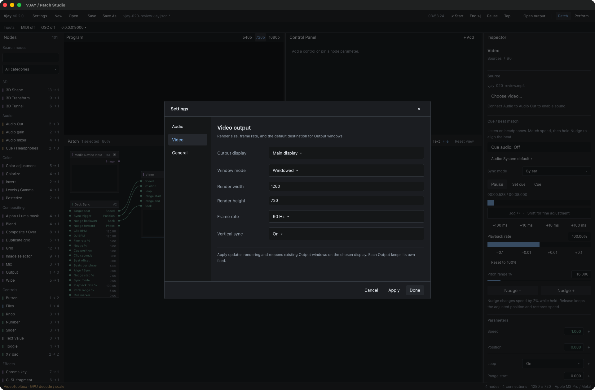

# Settings, capture, and matching by ear

## Settings

Open **Settings** in the toolbar, or press **Cmd+,** / **Ctrl+,**.

- **Audio:** output device, stereo channel pair, sample rate, buffer size, and master volume.
  Device default is available for rate and buffer size. Unsupported device configurations
  are rejected. The chosen device is used by both Audio Out and Cue / Headphones.
- **Video:** render width and height, requested frame rate, vertical sync, output display,
  and windowed or fullscreen output. Applying destination changes reopens existing Output
  windows; their graph connections and independent feeds are retained.
- **General:** default file name proposed for new projects and Save As.

**Apply** saves settings and keeps the window open. **Done** applies and closes it.
**Cancel**, the close button, and Escape discard unapplied edits. Escape first dismisses
an open choices menu. Closing the Settings window does not revert an earlier Apply.

Settings are separate from `.vjay.json` projects. On macOS they are stored in
`~/Library/Application Support/VJAY/settings.json`. `VJAY_SETTINGS_PATH` overrides the
location, including for isolated tests. Explicit `--size WIDTHxHEIGHT` overrides the saved
render dimensions for that launch. Frame rate is a scheduling target, not a measured FPS
or a guarantee that the display and graph can sustain that rate. Presentation also depends
on the display refresh rate and vertical sync.

The selected audio device and channel pair carry the mixed output of Audio Out and Cue.
Use headphones on that device when matching by ear. Separate devices or separate channel
pairs for program audio and cue audio are not currently supported. Unconnected audio
outputs do not open a device. Changing device, rate, channels, or buffer size restarts audio;
changing master volume does not restart the stream.

## Media Device Input

1. Add **Media Device Input** from Sources.
2. In Inspector, choose a camera or capture device, a capture size, and a frame rate.
3. Set **Capture** to **On**, then allow camera access when macOS prompts.
4. Connect Image to an effect or Output. The node preview follows the same GPU texture.

Capture is off by default. Devices are identified by their persistent native IDs; the
picker displays their names. Unplugged devices, denied permissions, unsupported size/rate
combinations, and startup failures are reported in Inspector. Toggle Capture off and on to
retry after reconnecting a device. Disable Capture when it is no longer needed.

The current camera adapter is macOS AVFoundation with Metal-compatible BGRA IOSurfaces.
`CVMetalTextureCache` wraps the captured frame and Metal Performance Shaders scale/convert
it into a persistent wgpu input texture. The capture callback replaces a single latest-frame
mailbox; at most two GPU copies are in flight. Late frames are dropped. Capture performs
no CPU pixel readback. It is a video input; microphone capture is not included.

The requested mode must be supported by the camera and AVFoundation session preset.
Windows and Linux camera adapters are not implemented. GPU tests use a generated IOSurface;
physical camera compatibility and permission prompts require testing on the target machine.

## Match a clip to the floor track without knowing BPM

Media transport is now independent of its rate controller. Select the Video node for
Seek, Jog, local Pause, Nudge and Cue. Select Deck Rate to change the base playback rate.
Seek Control displays the media node's actual Playhead while emitting separate Seek requests.

See [Subpatches and media transport](PATCHING_AND_TRANSPORT.md) for the current workflow,
Control Panel seek bars, external trigger connections, and saved-project compatibility.
