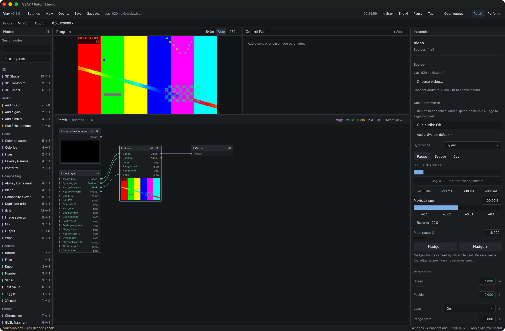

# Settings, capture, and matching by ear

## Settings

Open **Settings** in the toolbar, or press **Cmd+,** / **Ctrl+,**.

- **Audio:** output device, stereo channel pair, sample rate, buffer size, and master volume.
  Device default is available for rate and buffer size. Unsupported device configurations
  are rejected. The chosen device is used by both Audio Out and Cue / Headphones.
- **Video:** render width and height, requested frame rate, vertical sync, output display,
  and windowed or fullscreen output. Applying destination changes reopens existing Output
  windows; their graph connections and independent feeds are retained.
- **General:** default file name proposed for new projects and Save As.

**Apply** saves settings and keeps the window open. **Done** applies and closes it.
**Cancel**, the close button, and Escape discard unapplied edits. Escape first dismisses
an open choices menu. Closing the Settings window does not revert an earlier Apply.

Settings are separate from `.vjay.json` projects. On macOS they are stored in
`~/Library/Application Support/VJAY/settings.json`. `VJAY_SETTINGS_PATH` overrides the
location, including for isolated tests. Explicit `--size WIDTHxHEIGHT` overrides the saved
render dimensions for that launch. Frame rate is a scheduling target, not a measured FPS
or a guarantee that the display and graph can sustain that rate. Presentation also depends
on the display refresh rate and vertical sync.

The selected audio device and channel pair carry the mixed output of Audio Out and Cue.
Use headphones on that device when matching by ear. Separate devices or separate channel
pairs for program audio and cue audio are not currently supported. Unconnected audio
outputs do not open a device. Changing device, rate, channels, or buffer size restarts audio;
changing master volume does not restart the stream.

## Media Device Input

1. Add **Media Device Input** from Sources.
2. In Inspector, choose a camera or capture device, a capture size, and a frame rate.
3. Set **Capture** to **On**, then allow camera access when macOS prompts.
4. Connect Image to an effect or Output. The node preview follows the same GPU texture.

Capture is off by default. Devices are identified by their persistent native IDs; the
picker displays their names. Unplugged devices, denied permissions, unsupported size/rate
combinations, and startup failures are reported in Inspector. Toggle Capture off and on to
retry after reconnecting a device. Disable Capture when it is no longer needed.

The current camera adapter is macOS AVFoundation with Metal-compatible BGRA IOSurfaces.
`CVMetalTextureCache` wraps the captured frame and Metal Performance Shaders scale/convert
it into a persistent wgpu input texture. The capture callback replaces a single latest-frame
mailbox; at most two GPU copies are in flight. Late frames are dropped. Capture performs
no CPU pixel readback. It is a video input; microphone capture is not included.

The requested mode must be supported by the camera and AVFoundation session preset.
Windows and Linux camera adapters are not implemented. GPU tests use a generated IOSurface;
physical camera compatibility and permission prompts require testing on the target machine.

## Match a clip to the floor track without knowing BPM

The VJ hears the DJ's track from the floor or an external monitoring source. VJAY cannot
infer the playing track's BPM from rekordbox history. The clip's local cue audio lets the
VJ compare the two by ear.

1. Load the clip in Video or Loadable Video and select it.
2. Under **Cue / Beat match**, choose the headphone audio device and turn **Cue audio: On**.
   This explicitly connects the clip's Audio output to Cue / Headphones.
3. Press **Connect Deck Sync…**. This explicitly adds a Deck Sync controller and connects
   Speed, Position, and Seek. It refuses to replace existing connections. Newly added
   controllers default to **By ear** mode; no BPM values are needed.
4. Find a matching phrase with the seek bar or **Jog**. Drag Jog left/right, or use the
   ±100 ms and ±10 ms buttons. Shift-drag makes Jog ten times finer. Jogs are relative to
   the current playhead, rather than the original clip cue.
5. Adjust **Playback rate** until the clip's beat and the floor beat stop drifting apart.
   The fader range defaults to ±16%. Use the ±0.1% / ±0.01% buttons for small changes;
   Shift-drag also works on the numeric value. Reset returns to 100%.
6. Hold **Nudge −** or **Nudge +** to align their beats. The clip temporarily runs 2%
   slower/faster; releasing restores its set rate and keeps the new phase.
7. Use **Set cue** to store the current position and **Cue** to return to it. **Pause/Play**
   affects that clip and its cue audio, preserving the chosen rate when resumed.

The controls adjust the actual video and optional clip audio through the same Speed,
Position, and Seek connections. Rate changes also change audio pitch; time stretching
and automatic audio beat detection are not implemented. Monitor audio is local and does
not modify the DJ's playback. Avoid routing the cue device into the venue's PA.

**BPM ratio** remains available when the clip and floor BPM are known. It retains Clip BPM,
DJ BPM, Tap, trim, and target-beat alignment. Older projects retain BPM ratio mode and their
existing cue when loaded. The serialized node ID remains `LipSync` for compatibility;
its displayed name is **Deck Sync**.
